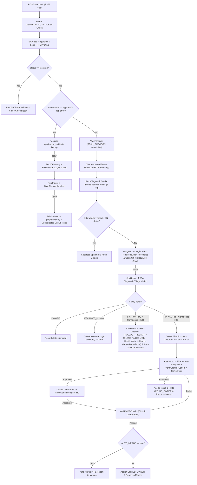

# AI Incident Commander

Autonomous Kubernetes & GitOps SRE responder written in Go (`1.27.4`), powered by a single-concurrency Antigravity CLI (`agy`) worker queue, multi-layer alert deduplication, post-soak Kubernetes/Helm/VictoriaLogs diagnostics, Go-allowlisted runtime remediation, proactive daily audit dispatch, Prometheus telemetry, and multi-stage GitHub PR & CI remediation.

---

## Overview

`ai-incident-commander` runs inside the `vinhthang.dev` Kubernetes fleet (cloned GitOps target repo `vinhthang/oci` at `WORKSPACE_DIR`) and exposes four HTTP endpoints:

- **`POST /webhook`** — Ingests Grafana Unified Alerting / Alertmanager JSON payloads (`POST`-only, `2 MiB` body cap, optional Bearer auth). Routes `resolved` webhooks to auto-close active issues, routes `apps` namespace application error alerts through Postgres deduplication + VictoriaLogs enrichment + read-only triage + dual-sink publishing (Memos & GitHub Issues), and runs cluster/edge alerts through stabilization soak, diagnostic bundling, hardware-reboot filtering, multi-layer deduplication (with closed-issue Postgres reconciliation), 4-way AI triage (`IGNORE`, `ESCALATE_HUMAN`, `FIX_VIA_PR`, or Go-allowlisted `FIX_RUNTIME`), and `#AutoRemediation` Memos + GitHub outcome reporting.
- **`POST /daily-report`** — Triggers a single-flight asynchronous fleet audit (`15m` budget) across Kubernetes nodes/workloads/Services/latest-CronJob failures/unbound PVCs (excluding transient self-trigger pods and >24h old restarts), `helm lint`, git history, VictoriaMetrics telemetry, and 24-hour incident DB history, publishing reports solely to Memos (`#DailyFleetCheck`, including `#ERROR` audits — no GitHub `[Daily Fleet Check]` issues are created), and dispatching bounded `PROACTIVE_ACTION` remediations (up to `DAILY_MAX_PROACTIVE_FIXES`, deduplicated against open GitHub work) with outcomes posted to GitHub (`ai-incident`, `proactive-fix`) and Memos (`#AutoRemediation`).
- **`GET /healthz`** — Reports HTTP liveness/readiness JSON (`status`, PostgreSQL `db` connectivity, and `queue_depth` of `minion.AgyQueue`).
- **`GET /metrics`** — Serves Prometheus text exposition (`commander_alerts_total`, `commander_triage_verdicts_total`, `commander_remediation_outcomes_total`, `commander_proactive_fixes_total`, `commander_daily_reports_total`, `commander_agy_jobs_total`, `commander_agy_duration_seconds`, and `commander_queue_depth`).

---

## Architecture & Alert Flow



### Minion Roles (`internal/minion/`)

All `agy` executions run sequentially (concurrency `1`, buffered channel `AgyQueue` capacity `100`) in `WORKSPACE_DIR` with context cancellation/expired-job fast-skip, isolated runtime auth (`~/.gemini/antigravity-cli`), and empty MCP config (`{"mcpServers":{}}`):

1. **Diagnostic Triage (`triage.go`)** — Read-only SRE evaluation of post-soak telemetry and `charts/vinhthang-fleet/` drift. Outputs `VERDICT: IGNORE`, `VERDICT: ESCALATE_HUMAN`, `VERDICT: FIX_VIA_PR`, or `VERDICT: FIX_RUNTIME` + `RUNTIME_ACTION:` (both fix verdicts require explicit `Confidence: HIGH` and pass Go validation; any lower confidence, missing target, or disallowed runtime target safely downgrades to `ESCALATE_HUMAN`).
2. **Fixer (`fixer.go`)** — Creates a minimal declarative fix on branch `fix/alert-<issue>-<ts>` (never `main`), validates with `helm template`, commits, and pushes (checked via non-empty `git diff main` and `workspace.VerifyBranchPushed`).
3. **Senior Fixer (`senior_fixer.go`)** — Local pre-review gate inspecting `git diff main` against governance rules (edge node 1GB RAM limits, pinned image tags, no port `8080`, root-cause correctness) before opening a PR.
4. **Reviewer (`reviewer.go`)** — Independent PR diff gatekeeper evaluating only newly introduced lines (`APPROVED` / `REJECTED`) before waiting on GitHub CI Check Runs.
5. **Daily Report (`daily_report.go`)** — Read-only fleet auditor emitting `HEALTH_STATUS: HEALTHY` or `ATTENTION_NEEDED` plus optional machine-parseable `PROACTIVE_ACTION:` directives (`FIX_VIA_PR` or `FIX_RUNTIME`) for verified root causes; Go strips `PROACTIVE_ACTION:` lines, dispatches up to `DAILY_MAX_PROACTIVE_FIXES` non-duplicate proactive tracking fixes (`ai-incident`, `proactive-fix` on GitHub and `#AutoRemediation` on Memos), and publishes the complete fleet audit + remediation summary solely to Memos (`#DailyFleetCheck`).
6. **App Incident Tracker (`app_fixer.go`)** — SHA-256 Postgres deduplication (`service|endpoint|statusCode`) and diagnosis persistence in `application_incidents` for `apps` namespace application alerts, paired with VictoriaLogs trace lookup and Memos/GitHub notification when `open`.

---

## Project Structure

| Path | Responsibility |
| :--- | :--- |
| `cmd/commander/main.go` | Process entrypoint, OTel tracer initialization (`OTEL_EXPORTER_OTLP_ENDPOINT` or stdout), DB/GitHub/Workspace startup, HTTP server (`/webhook`, `/daily-report`, `/healthz`, `/metrics`), graceful shutdown |
| `internal/config/config.go` | Environment configuration parsing (`GetEnv`, `ParseDurationEnv`, `ParseBoolEnv`, `ParseIntEnv`, `ParseCSVEnv`) |
| `internal/webhook/` | `/webhook`, `/daily-report`, `/healthz` handlers, alert routing, `apps` & `#AutoRemediation` Memos/GitHub reporters (`remediation_report.go`), bounded proactive daily loop (`daily_report.go`), and 3-attempt GitOps remediation orchestration |
| `internal/metrics/` | Zero-dependency Prometheus text exposition (`HandleMetrics`, counters including `commander_proactive_fixes_total`, `agy` duration histogram, live queue depth gauge) |
| `internal/minion/` | Context-aware single-worker `AgyQueue`, runtime auth sync, 4-way triage, proactive daily action parser, fixer/senior-fixer/reviewer/daily-report minions, `app_fixer` Postgres tracking |
| `internal/k8s/` | `CheckWorkloadStatus`, `FetchTelemetry`, `FetchDiagnosticBundle`, `FetchVictoriaLogsContext`, signal-filtered `CollectDailyFleetSnapshot`, and Go-enforced runtime remediation allowlist (`remediate.go`) |
| `internal/incident/` | `ComputeFingerprint`, scraper-aware `ExtractTargetResource`, `NormalizeWorkloadBase`, `IsEphemeralNodeOutage`, `ReconcileClosedClusterIssue`, and `cluster_incidents` SQL helpers |
| `internal/state/` | `ActiveIncidents` map, `WaitForSoak` early-cancel channels, `AcquireIncidentLock` (`5m` cooldown), `AcquireResolveLock` (`1m` debounce), and TTL pruning (`pruneExpiredLocked`) |
| `internal/github/` | Context-propagated `go-github/v59` wrapper for Issues (`IsIssueOpen`), PRs, status-checked `GetPullRequestDiff` (`30s` timeout), open Issue/PR deduplication, Check Run polling (`WaitForPRChecks`), and PR merge |
| `internal/db/` | PostgreSQL connection & migrations (`application_incidents`, `cluster_incidents`) and Memos formatters/insertion (`#DailyFleetCheck`, `#AppIncident`, `#AutoRemediation`) |
| `internal/workspace/` | Mutex-guarded git workspace operations (`InitWorkspace`, force-clean `ResetToMain`, `CreateAndCheckoutBranch`, `GetLocalDiff`, `VerifyBranchPushed`) |
| `internal/prompt/` | Unescaped `text/template` prompt rendering from `/etc/commander/templates/*.tmpl` with `//go:embed defaults/*.tmpl` fallback |
| `docs/specs/` | Five-document feature specifications and catalog (`INDEX.md`) |

---

## Configuration

| Variable | Description | Default |
| :--- | :--- | :--- |
| `PORT` | HTTP server listen port | `8085` |
| `WEBHOOK_AUTH_TOKEN` | Expected Bearer token for `POST /webhook` and `POST /daily-report` (open if unset) | `""` |
| `AGY_MODEL` | Model passed to `/usr/local/bin/agy --model` (falls back to `GEMINI_MODEL`) | `gemini-3.8-flash-medium` |
| `GEMINI_MODEL` | Fallback model identifier when `AGY_MODEL` is unset | `gemini-3.5-flash` |
| `GEMINI_API_KEY` | Optional Gemini API key environment variable | `""` |
| `AGY_HOST_AUTH_DIR` | Host directory containing `antigravity-oauth-token`, `installation_id`, `settings.json` | `""` |
| `GITHUB_TOKEN` | GitHub PAT for Issues/PRs/Check Runs and HTTPS git auth rewrite | *Required* |
| `GITHUB_OWNER` | Target GitOps repository owner and default human assignee | `vinhthang` |
| `GITHUB_REPO` | Target GitOps repository name | `oci` |
| `WORKSPACE_DIR` | Local git checkout path for the target GitOps repository | `/app/workspace/oci` |
| `SOAK_DURATION` | Pre-triage stabilization soak duration (`0s` disables soak) | `60s` |
| `AUTO_MERGE` | Auto-merge PRs after Reviewer approval and passing CI Check Runs | `false` |
| `ENABLE_RUNTIME_REMEDIATION` | Enable Go-allowlisted runtime Kubernetes remediation (`ROLLOUT_RESTART`, `DELETE_FAILED_JOB`) | `true` |
| `RUNTIME_PROTECTED_NAMESPACES` | Comma-separated namespaces blocked from runtime mutations | `kube-system,kube-public,kube-node-lease,data` |
| `RUNTIME_VERIFY_TIMEOUT` | Post-restart `kubectl rollout status --timeout` duration | `90s` |
| `ENABLE_DAILY_PROACTIVE_FIX` | Enable dispatching verified `PROACTIVE_ACTION` fixes from `/daily-report` | `true` |
| `DAILY_MAX_PROACTIVE_FIXES` | Maximum non-duplicate proactive fixes dispatched per `/daily-report` run | `3` |
| `DB_DSN` | PostgreSQL DSN for `cluster_incidents` and `application_incidents` (disabled if unset) | `""` |
| `MEMOS_DB_DSN` | PostgreSQL DSN for private Memos `#DailyFleetCheck`, `#AppIncident`, and `#AutoRemediation` notes | `""` |
| `VICTORIAMETRICS_URL` | VictoriaMetrics base URL queried during `/daily-report` snapshots | `http://victoriametrics.observability.svc.cluster.local:8428` |
| `VICTORIALOGS_URL` | VictoriaLogs base URL queried via `/select/logsql/query` for `apps` incidents | `http://victorialogs.observability.svc.cluster.local:9428` |
| `OTEL_EXPORTER_OTLP_ENDPOINT` | OTLP gRPC trace exporter endpoint (falls back to stdout exporter if unset) | `""` |

### Least-Privilege Kubernetes RBAC (`vinhthang/oci`)

Runtime fixes (`ROLLOUT_RESTART` on `Deployment`/`StatefulSet` and `DELETE_FAILED_JOB` on finished failed `Job`s) are enforced strictly inside Go (`internal/k8s/remediate.go`). Protected namespaces (`kube-system`, `kube-public`, `kube-node-lease`, `data`), core database workloads (`postgres`, `mongodb`, `redis`, `pulsar`, `etcd`), and self-restart (`system/ai-incident-commander`) are blocked in code.

Because the deployed pod's `ClusterRole/ai-incident-commander-reader` starts read-only, add only these narrow rules to its `ClusterRole` in `vinhthang/oci` when enabling live cluster runtime fixes (zero `secrets`, `pvcs`, `nodes`, or `pods/exec` write permissions):

```yaml
rules:
  - apiGroups: ["apps"]
    resources: ["deployments", "statefulsets"]
    verbs: ["get", "list", "watch", "patch"]
  - apiGroups: ["batch"]
    resources: ["jobs", "cronjobs"]
    verbs: ["get", "list", "watch", "delete"]
```

If RBAC has not yet been updated on the cluster, Go classifies `Forbidden` cleanly (`runtime_rbac_denied`), keeps the GitHub issue open assigned to `GITHUB_OWNER`, and logs the note to Memos without crashing.

### Prompt Template Overrides

Prompt templates (`triage.tmpl`, `fixer.tmpl`, `senior_fixer.tmpl`, `reviewer.tmpl`, `daily_report.tmpl`) are embedded in the binary from `internal/prompt/defaults/`. Mounting custom `.tmpl` files under `/etc/commander/templates/` via a Kubernetes `ConfigMap` overrides individual templates without rebuilding the binary.

---

## Local Development, Testing & Container Image

```bash
# Run all unit tests (uncached)
go test -v -count=1 ./...

# Static analysis
go vet ./...

# Build binary (place output in bin/, which is gitignored)
CGO_ENABLED=0 go build -o bin/incident-commander ./cmd/commander
```

GitHub Actions (`.github/workflows/ci-cd.yml`) runs `golangci-lint` (`v2.15.0`), `go test -v ./...`, builds `linux/amd64` and `linux/arm64` static binaries, and publishes multi-arch images on pushes to `main`:

```bash
docker pull ghcr.io/vinhthang/ai-incident-commander:latest
```

Specifications:
- Baseline: [2026-11-22-ai-incident-commander-baseline](docs/specs/2026-11-22-ai-incident-commander-baseline/spec.md)
- Reliability & Observability Delta: [2026-11-22-commander-reliability-and-observability](docs/specs/2026-11-22-commander-reliability-and-observability/spec.md)
- Autonomous Runtime & Proactive Audit Delta: [2026-11-23-autonomous-remediation-and-proactive-audit](docs/specs/2026-11-23-autonomous-remediation-and-proactive-audit/spec.md)
- Memos-Only Daily Fleet Reports Delta: [2026-11-25-daily-report-memos-only](docs/specs/2026-11-25-daily-report-memos-only/spec.md)
