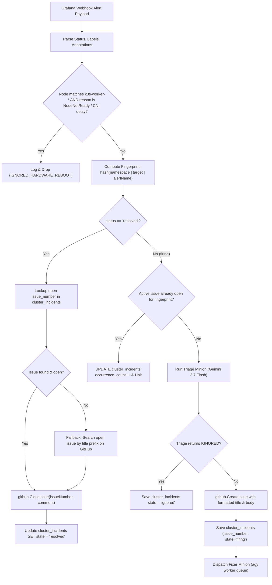

# Technical Design: Alert Deduplication & Auto-Closing

**Feature ID**: `alert-dedup-and-autoclose`  
**Status**: Draft  

---

## 1. System Architecture



---

## 2. Component Design & Code Contracts

### A. `internal/github/client.go`
Add:
```go
func CloseIssue(issueNumber int, comment string) error {
    if comment != "" {
        _ = AddIssueComment(issueNumber, comment)
    }
    state := "closed"
    req := &github.IssueRequest{State: &state}
    _, _, err := Client.Issues.Edit(context.Background(), config.GithubOwner, config.GithubRepo, issueNumber, req)
    return err
}

func FindOpenIssueByTitle(titlePrefix string) (*github.Issue, error) {
    opts := &github.IssueListByRepoOptions{
        State:       "open",
        Labels:      []string{"ai-incident"},
        ListOptions: github.ListOptions{PerPage: 50},
    }
    issues, _, err := Client.Issues.ListByRepo(context.Background(), config.GithubOwner, config.GithubRepo, opts)
    if err != nil {
        return nil, err
    }
    for _, issue := range issues {
        if strings.HasPrefix(issue.GetTitle(), titlePrefix) {
            return issue, nil
        }
    }
    return nil, nil
}
```

### B. `internal/db/db.go`
Add migration to create `cluster_incidents` table:
```sql
CREATE TABLE IF NOT EXISTS cluster_incidents (
    fingerprint VARCHAR(255) PRIMARY KEY,
    alert_name VARCHAR(255) NOT NULL,
    namespace VARCHAR(255) NOT NULL,
    target_resource VARCHAR(255) NOT NULL,
    issue_number INT DEFAULT 0,
    state VARCHAR(50) DEFAULT 'firing',
    occurrence_count INT DEFAULT 1,
    created_at TIMESTAMP DEFAULT CURRENT_TIMESTAMP,
    updated_at TIMESTAMP DEFAULT CURRENT_TIMESTAMP
);
```

### C. `internal/webhook/handler.go`
* Compute deterministic alert fingerprint from labels:
  - `target = pod` || `statefulset` || `deployment` || `service` || `app`
  - `namespace = labels["namespace"]` || `"default"`
  - `fingerprint = getIncidentFingerprint(namespace, target, alertName)`
* Check hardware suppression before Triage:
  - If `strings.HasPrefix(labels["node"], "k3s-worker-")` and `NodeNotReady` or `flannel` error, drop immediately.
* Handle `status == "resolved"`:
  - Query `cluster_incidents` for active `issue_number`.
  - Close issue with `github.CloseIssue`.
  - Mark state as `resolved`.
* Handle `status == "firing"`:
  - Query `cluster_incidents`. If active row with `state == 'firing'` exists, update count and exit.
  - If not found, execute Triage and CreateIssue, saving `issue_number` back to database.
